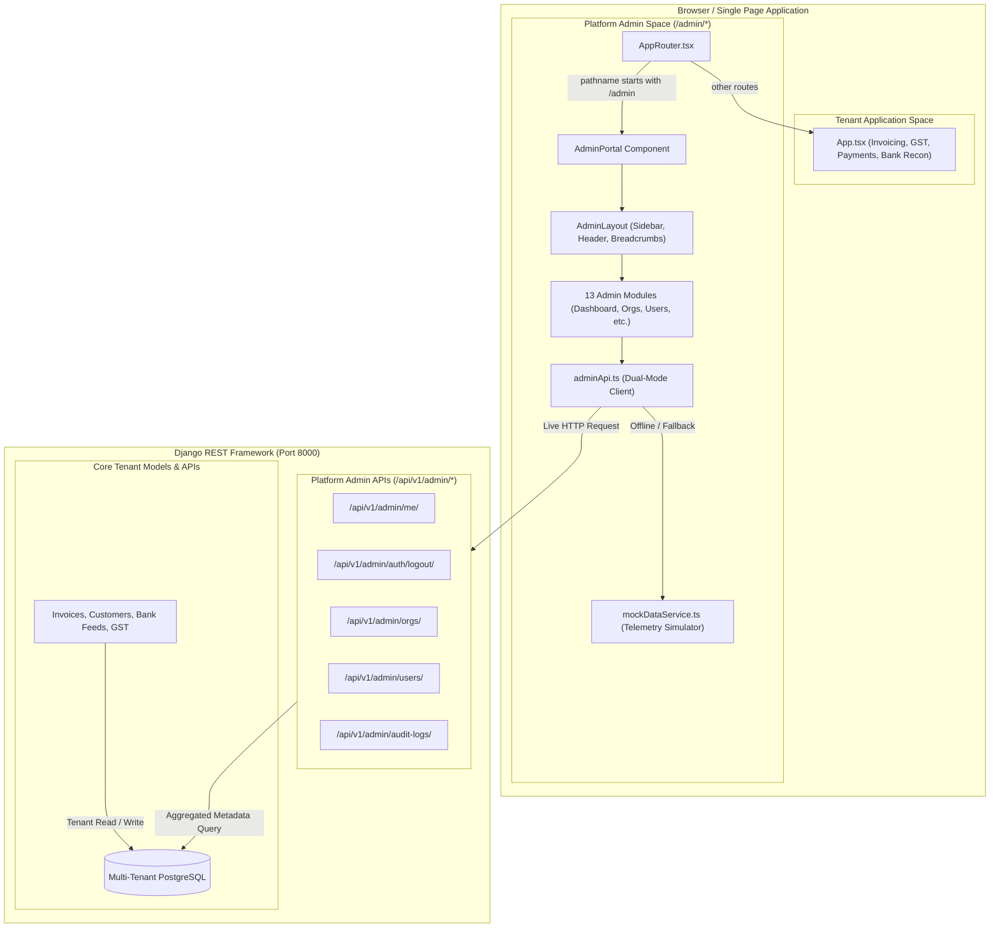
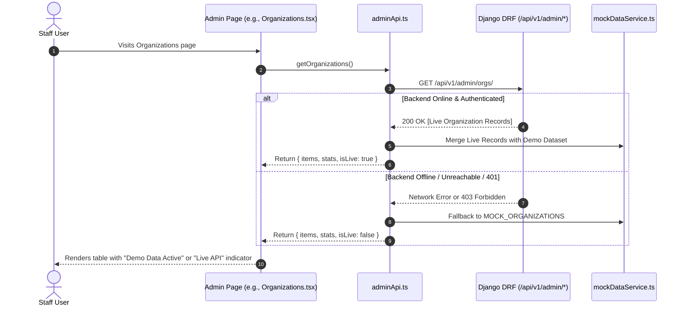

# 01 — System Architecture & Data Boundary

> **Document:** `documentation/platform-admin-flow/01_ARCHITECTURE_OVERVIEW.md`  
> **Topic:** High-Level Architecture, Zero-Trust Privacy, Dual-Mode API, and Component Topography

---

## 1. System Topology Overview

FinPilot AI employs a decoupled architecture comprising a single-page React frontend and a Django REST Framework (DRF) backend:

---

## 2. Platform Isolation & Privacy Boundaries

### Strict Route Separation
The separation between customer tenant operations and platform operations occurs at the root router level in `frontend/src/app/AppRouter.tsx`:

- If `window.location.pathname.startsWith('/admin')`:
  The application boots into the `AdminPortal` context. No tenant data hooks, tenant context providers, or tenant navigation bars are mounted.
- If `window.location.pathname` does **not** start with `/admin`:
  The standard multi-tenant accounting application (`App.tsx`) is mounted.

### The Zero-Trust Financial Privacy Model
A core tenet of the FinPilot AI architecture is strict financial privacy for tenants:
1. **Metadata & Telemetry Only:** Platform administrators have visibility into tenant health (e.g., active status, subscription plan tier, total count of invoices created, AI token usage, count of active team members).
2. **No Tenant Data Exposure:** The platform admin panel does **not** query or expose:
   - Line items of customer invoices.
   - Bank account balances or transaction details.
   - Customer PAN/GSTIN confidential audit data.
   - Customer chat prompts containing confidential financial data.
3. **Audited Impersonation:** Should technical support require access to a customer workspace to resolve an issue, access is strictly governed by the **Support Access** module (`SupportAccess.tsx`), which requires explicit time-bound session creation, dual confirmation, and complete logging to the immutable audit trail.

---

## 3. Dual-Mode API Strategy (Live DRF + Fallback)

To enable robust development, testing, and uninterrupted demonstrations, the frontend incorporates a **dual-mode data client** in `frontend/src/admin/services/adminApi.ts`:

### Key Benefits of Dual-Mode Architecture:
1. **Zero UI Crash:** If the Django development server is restarted, unmigrated, or offline, the UI continues functioning smoothly with simulated telemetry.
2. **Clear Indicator in Header:** When mock/telemetry data is used, the toolbar displays a distinct **"Demo Data Active"** indicator so operators are always aware of data provenance.
3. **Seamless Transition:** When live Django endpoints are populated with real tenant databases, live records automatically supersede mock entries without changing frontend component code.

---

## 4. State & Session Architecture

### Session Preservation
- The admin session is evaluated on mount by the `useAdminAuth` hook (`frontend/src/admin/hooks/useAdminAuth.ts`).
- Authentication status is verified against `/api/v1/admin/me/` which checks the Django session cookie (`sessionid`).
- When running in local development mode without a Django session, simulated sessions can be initiated for testing the UI.

### CSRF Protection
- The frontend enforces CSRF cookie synchronization using `/api/v1/auth/csrf/`.
- Every mutating request (`POST`, `PUT`, `DELETE`, `PATCH`) automatically reads the `csrftoken` cookie and attaches it via the `X-CSRFToken` request header.

### Browser History Integration
- The routing in `AppRouter.tsx` uses standard HTML5 History API (`window.history.pushState` and `window.addEventListener('popstate')`).
- Deep links (such as `/admin/organizations?id=de042d83-8642-40b9-abe3-9f1aae4f28f0`) parse query strings automatically and support standard browser Back/Forward navigation.

