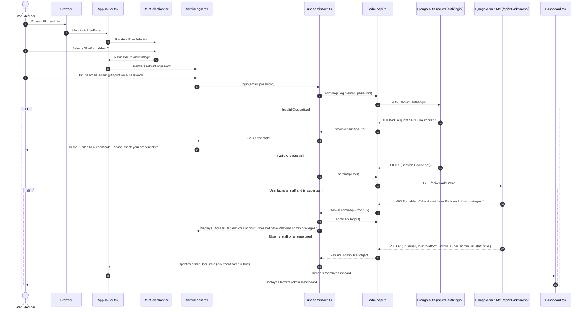

# 02 — Authentication, Sessions & Role Verification

> **Document:** `documentation/platform-admin-flow/02_AUTHENTICATION_AND_ROLES.md`  
> **Topic:** Sign-In Sequence, Session Management, Role Enforcement & RBAC Matrix

---

## 1. Authentication Flow: Step-by-Step

The Platform Admin sign-in process is a gated, multi-stage workflow designed to prevent regular tenant users from discovering or authenticating against platform operational interfaces.



---

## 2. Component Implementation Details

### Stage 1: Role Selection Portal (`RoleSelection.tsx`)
- **File:** `frontend/src/admin/pages/auth/RoleSelection.tsx`
- **Route:** `/admin`
- **Purpose:** Gateway screen that forces staff to declare their operational role.
- **Available Roles in UI:**
  1. **Platform Admin (Active):** Platform operations & tenant oversight. Proceeding routes user to `/admin/login`.
  2. **Super Admin (Restricted):** Complete system governance. Currently mapped to same backend auth with role elevation.
  3. **Support Agent (Restricted in preview):** Displays notification banner: *"The Support Agent portal is restricted in this release. Please select Platform Admin."*
  4. **Analyst (Restricted in preview):** Displays notification banner: *"The Analyst portal is restricted in this release. Please select Platform Admin."*

### Stage 2: Staff Login (`AdminLogin.tsx`)
- **File:** `frontend/src/admin/pages/auth/AdminLogin.tsx`
- **Route:** `/admin/login`
- **Purpose:** Secure credential entry form.
- **Key Features:**
  - Client-side email RFC 5322 regex validation.
  - Password visibility toggle (`Eye` / `EyeOff` icons).
  - "Remember this device for 30 days" toggle.
  - "Forgot staff credentials?" simulation flow with auto-dismissing confirmation banner.
  - Integrated `AdminButton` with synchronous submission spinner.
  - Auto-redirection: If `adminUser` is already authenticated, `/admin/login` automatically pushes to `/admin/dashboard`.

### Stage 3: Authentication Hook (`useAdminAuth.ts`)
- **File:** `frontend/src/admin/hooks/useAdminAuth.ts`
- **Purpose:** Encapsulates the entire lifecycle of an admin session.
- **Methods:**
  - `checkSession()`: Executes on mount. Calls `adminApi.me()`. If user role does not match `platform_admin` or `super_admin`, sets a 403 Forbidden state.
  - `login(email, password)`: Submits credentials, then invokes `adminApi.me()` to verify staff rights. If unauthorized, immediately triggers `adminApi.logout()` to destroy the unauthorized cookie session.
  - `logout()`: Terminates backend session and clears React state.
  - `clearError()`: Resets transient error messages.

---

## 3. Backend Verification Logic

### The Endpoint: `GET /api/v1/admin/me/`
- **File:** `backend/platform_admin/views/auth_views.py`
- **Permissions Required:** `rest_framework.permissions.IsAuthenticated`

```python
@api_view(["GET"])
@permission_classes([permissions.IsAuthenticated])
def admin_me(request):
    user = request.user
    
    # Determine platform role
    if user.is_superuser:
        role = "super_admin"
    elif user.is_staff:
        role = "platform_admin"
    else:
        return Response(
            {"detail": "Access Denied: You do not have Platform Admin privileges.", "role": None},
            status=status.HTTP_403_FORBIDDEN,
        )

    return Response({
        "id": user.id,
        "email": user.email,
        "full_name": user.get_full_name() or user.username,
        "role": role,
        "is_staff": user.is_staff,
        "is_superuser": user.is_superuser,
    })
```

### The Sign Out Endpoint: `POST /api/v1/admin/auth/logout/`
- **File:** `backend/platform_admin/views/auth_views.py`
- Flushes the Django session store for the request and expires the session cookie.

---

## 4. Role-Based Access Control (RBAC) Matrix

Defined in `frontend/src/admin/permissions/adminRoles.ts`:

| Permission Capability | Super Admin (`super_admin`) | Platform Admin (`platform_admin`) | Support Agent (`support_agent`) | Analyst (`analyst`) |
|---|:---:|:---:|:---:|:---:|
| **Access Platform Admin UI** | Yes | Yes | Yes (Upcoming) | Yes (Upcoming) |
| **Manage Organizations** | Yes | Yes | Read-Only | Read-Only |
| **Manage Customer Users** | Yes | Yes | Read-Only | No |
| **Manage Subscriptions** | Yes | Yes | No | No |
| **Manage Usage Quotas & Overrides** | Yes | Yes | No | Read-Only |
| **Monitor AI Usage & Costs** | Yes | Yes | No | Read-Only |
| **Toggle Global AI Kill-Switch** | Yes | Yes | No | No |
| **Manage Payment Reminders Engine**| Yes | Yes | No | No |
| **Inspect System Operations / Celery**| Yes | Yes | No | No |
| **Inspect Audit Logs** | Yes | Yes | Yes | Yes |
| **Manage Platform Settings** | Yes | Yes | No | No |
| **Zero-Trust Support Impersonation** | Yes | Yes | Request Only | No |
| **Manage Subscription Plans** | **YES** | **BLOCKED** | **BLOCKED** | **BLOCKED** |
| **Manage Staff Roles & Invites** | **YES** | **BLOCKED** | **BLOCKED** | **BLOCKED** |

---

## 5. Super Admin Gating in UI

Two critical modules are reserved exclusively for **Super Admins**:
1. **Plans Management (`/admin/plans`)**: Creation and pricing updates of subscription tiers.
2. **Staff Management (`/admin/staff`)**: Adding, editing, and revoking staff access.

### Route Guard in `AppRouter.tsx`:
```tsx
if (pathname === '/admin/plans' || pathname === '/admin/staff') {
  if (adminUser && adminUser.role !== 'super_admin') {
    navigate('/admin/dashboard')
  }
  // ...
}
```

### Visual Interceptor in `AdminSidebar.tsx`:
When a `platform_admin` hovers or clicks on a restricted item in the sidebar:
- A lock icon is displayed.
- Clicking the item does not navigate; instead, a notification pops up:  
  *"Super Admin Restricted: '[Module Name]' is inaccessible to Platform Admin role."*

