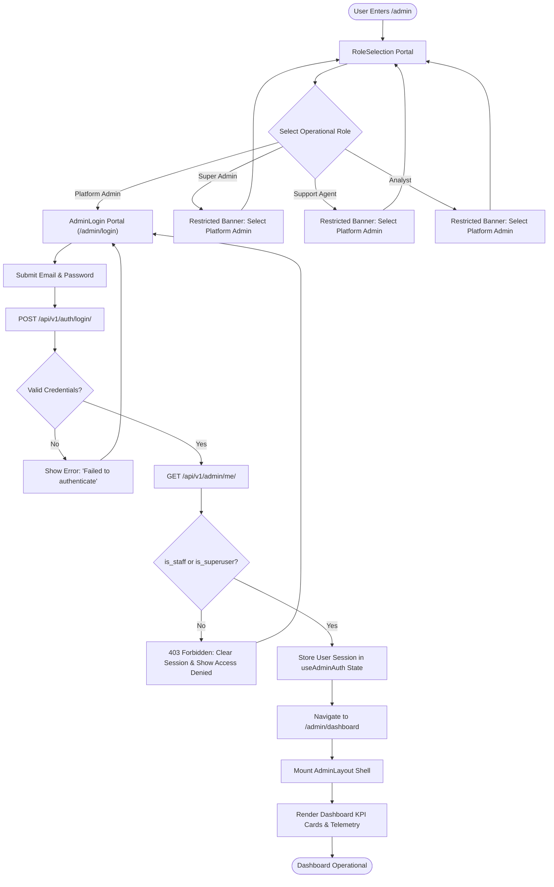
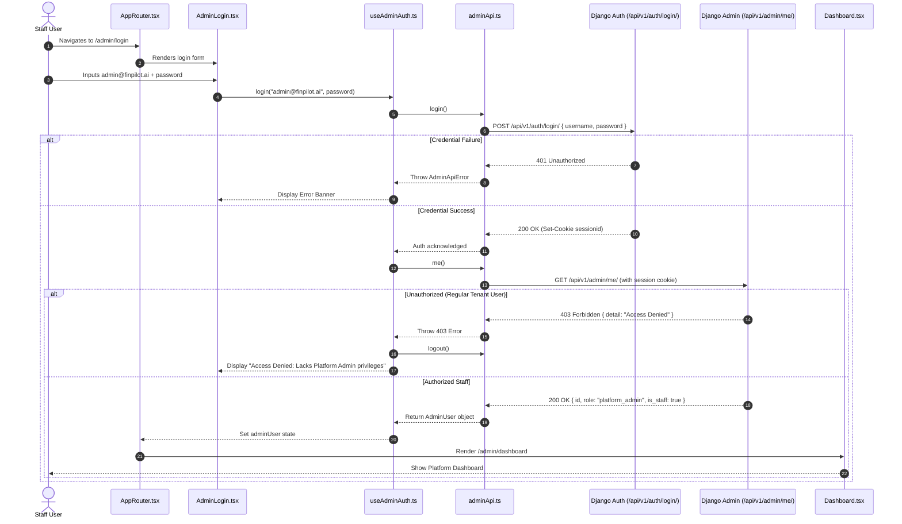
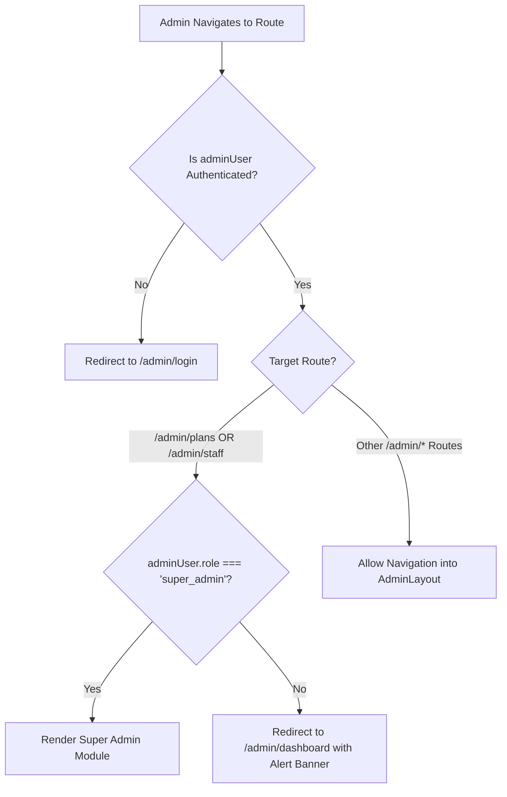
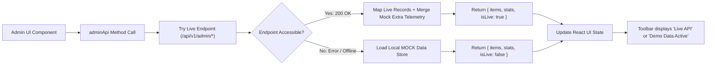
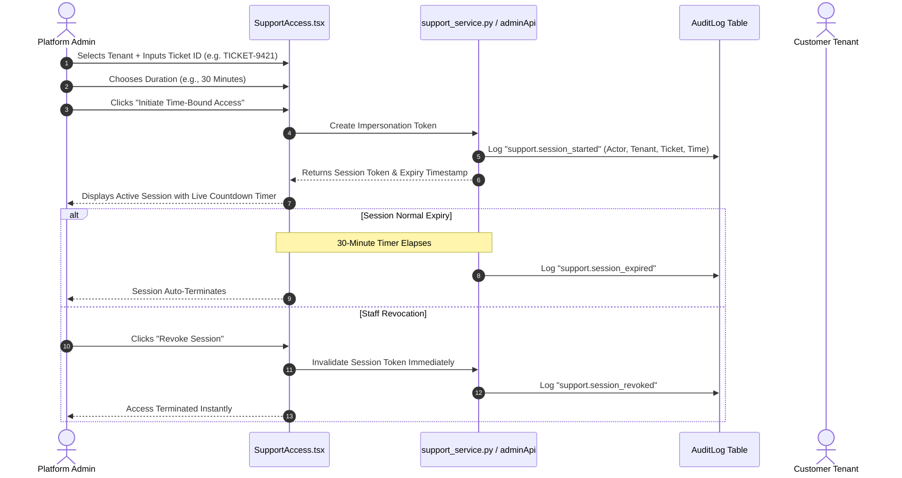

# 06 — Flowcharts & Sequence Diagrams

> **Document:** `documentation/platform-admin-flow/06_FLOWCHARTS_AND_DIAGRAMS.md`  
> **Topic:** Mermaid Architecture Diagrams, Sign-In Sequences, RBAC Decision Trees & Workflows

---

## 1. End-to-End Sign In to Platform Admin Dashboard Flow

---

## 2. Authentication & Verification Detailed Sequence

---

## 3. RBAC Role Verification & Route Decision Tree

---

## 4. Dual-Mode Data Pipeline (Live DRF vs Mock Fallback)

---

## 5. Zero-Trust Support Access Workflow

