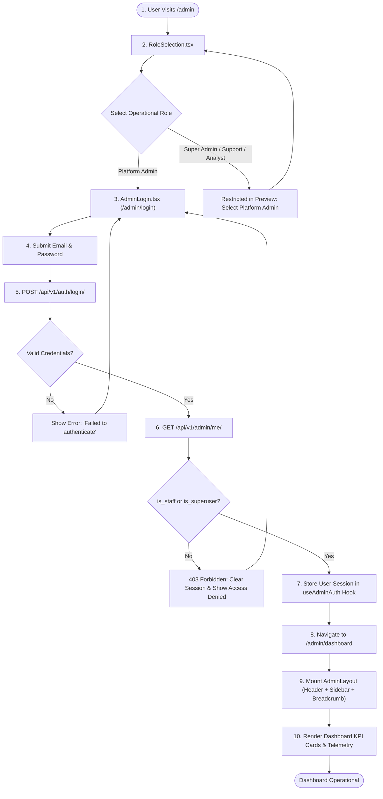
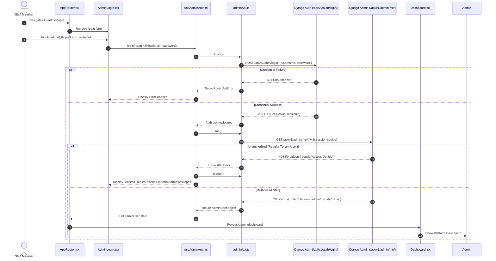
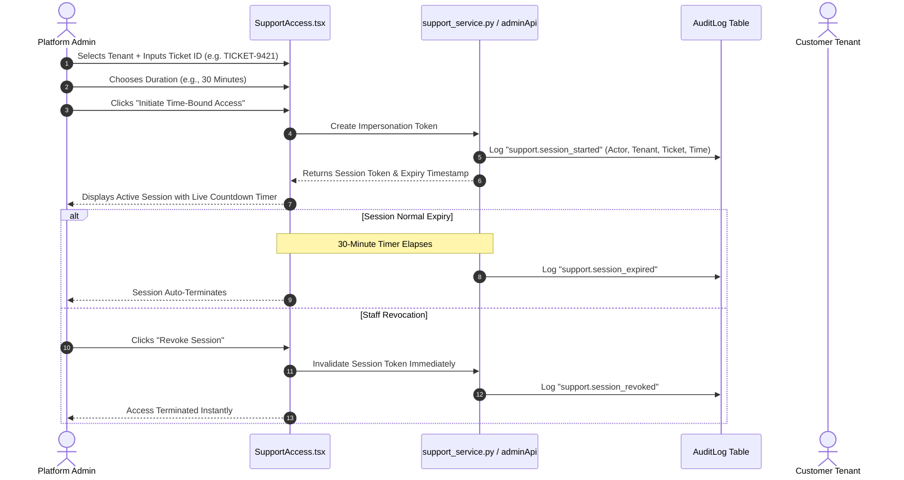

# FinPilot AI — Platform Admin Panel: Complete Flow & Technical Architecture Guide

> **Consolidated Document for LLM Import & Team Reference**  
> **Repository:** FinPilot AI Platform  
> **Source Directory:** `c:\Users\ankit\OneDrive\Desktop\FinPilotAi-latest`  
> **Generated:** November 2026  
> **Applicable For:** ChatGPT, Claude, Technical Due Diligence, System Architecture Reviews

---

## Table of Contents
1. [Executive System Summary](#1-executive-system-summary)
2. [End-to-End Sign In to Platform Admin Dashboard Flow](#2-end-to-end-sign-in-to-platform-admin-dashboard-flow)
3. [Authentication, Role Verification & RBAC Deep-Dive](#3-authentication-role-verification--rbac-deep-dive)
4. [Routing & Application Shell Architecture](#4-routing--application-shell-architecture)
5. [Complete Module & Page Functionality Catalog](#5-complete-module--page-functionality-catalog)
6. [API Contracts, Data Schemas & Dual-Mode Mechanics](#6-api-contracts-data-schemas--dual-mode-mechanics)
7. [Visual Flowcharts & Sequence Diagrams](#7-visual-flowcharts--sequence-diagrams)
8. [Codebase File Map & Direct References](#8-codebase-file-map--direct-references)

---

## 1. Executive System Summary

FinPilot AI is a dual-plane financial platform composed of:
1. **Customer Tenant Workspace (`App.tsx`):** Multi-tenant GST billing, e-invoicing, payments reconciliation, bank feeds, cash flow forecasting, and tenant-scoped AI chat.
2. **Platform Admin Panel (`/admin/*`):** Isolated administrative SaaS control plane for internal platform staff to monitor tenant health, aggregate metrics, manage subscriptions, govern AI costs, audit operations, and perform zero-trust technical support.

### Core Architectural Guarantees
- **Strict Boundary Separation:** The Platform Admin portal is decoupled from tenant workspace state. Routing is gated at the root in `frontend/src/app/AppRouter.tsx`.
- **Zero-Trust Financial Privacy Boundary:** Platform administrators can view aggregate metrics, telemetry counts, and metadata (e.g., number of invoices, quota usage, status), but **never** see customer financial records, line-item tax invoices, or bank balances.
- **Multi-Tier RBAC:** Gated by server-side verification (`is_staff`, `is_superuser`), with granular operational roles (`super_admin`, `platform_admin`, `support_agent`, `analyst`).
- **Dual-Mode Data Strategy:** Live Django REST Framework API endpoints (`/api/v1/admin/*`) backed by high-fidelity fallback telemetry and simulation data for seamless development and offline operation.

---

## 2. End-to-End Sign In to Platform Admin Dashboard Flow

### Detailed Step-by-Step Breakdown

1. **Gateway Access (`/admin`):**
   - User navigates to `/admin`.
   - `AppRouter.tsx` detects `window.location.pathname.startsWith('/admin')` and mounts `AdminPortal`.
   - If not authenticated, renders `RoleSelection.tsx`.

2. **Role Selection (`RoleSelection.tsx`):**
   - User is presented with 4 operational role cards: `Platform Admin`, `Super Admin`, `Support Agent`, `Analyst`.
   - Selecting `Platform Admin` navigates to `/admin/login`. Other roles present a preview restriction badge.

3. **Staff Sign-In (`AdminLogin.tsx`):**
   - Staff enters operational email (`admin@finpilot.ai`) and password.
   - Client-side RFC 5322 regex validates email format.
   - Password toggle (`Eye`/`EyeOff`) and "Remember device" options are available.
   - Form submission invokes `login(email, password)` from `useAdminAuth.ts`.

4. **Credential Verification (`POST /api/v1/auth/login/`):**
   - Backend authenticates credentials using standard Django session authentication.
   - On success, sets the HTTP-only session cookie (`sessionid`).

5. **Platform Role Verification (`GET /api/v1/admin/me/`):**
   - Backend `auth_views.py` inspects `request.user`:
     * If `is_superuser`: returns role `"super_admin"`.
     * If `is_staff`: returns role `"platform_admin"`.
     * Otherwise: returns HTTP `403 Forbidden` (`{"detail": "Access Denied: You do not have Platform Admin privileges."}`).
   - If 403 is received, `useAdminAuth` immediately invokes `adminApi.logout()` to destroy the unauthorized cookie session and displays an access denied banner.

6. **Shell Mounting & Dashboard Display:**
   - On verified staff response, `useAdminAuth` sets `adminUser` state.
   - `AppRouter.tsx` redirects to `/admin/dashboard`.
   - `AdminLayout.tsx` wraps the view with `AdminHeader`, `AdminSidebar`, and `AdminBreadcrumb`.
   - `Dashboard.tsx` loads KPI cards, subscription health ring, and live platform activity feed.

---

## 3. Authentication, Role Verification & RBAC Deep-Dive

### RBAC Permission Matrix (`frontend/src/admin/permissions/adminRoles.ts`)

| Capability | Super Admin (`super_admin`) | Platform Admin (`platform_admin`) | Support Agent (`support_agent`) | Analyst (`analyst`) |
|---|:---:|:---:|:---:|:---:|
| **Access Platform Admin UI** | Yes | Yes | Yes (Preview) | Yes (Preview) |
| **Manage Organizations** | Yes | Yes | Read-Only | Read-Only |
| **Manage Customer Users** | Yes | Yes | Read-Only | No |
| **Manage Subscriptions** | Yes | Yes | No | No |
| **Manage Usage Quotas & Overrides** | Yes | Yes | No | Read-Only |
| **Monitor AI Usage & Costs** | Yes | Yes | No | Read-Only |
| **Toggle Global AI Kill-Switch** | Yes | Yes | No | No |
| **Manage Payment Reminders Engine** | Yes | Yes | No | No |
| **Inspect System Operations / Celery** | Yes | Yes | No | No |
| **Inspect Audit Logs** | Yes | Yes | Yes | Yes |
| **Manage Platform Settings** | Yes | Yes | No | No |
| **Zero-Trust Support Impersonation** | Yes | Yes | Request Only | No |
| **Manage Subscription Plans** | **YES** | **BLOCKED** | **BLOCKED** | **BLOCKED** |
| **Manage Staff Roles & Invites** | **YES** | **BLOCKED** | **BLOCKED** | **BLOCKED** |

### Super Admin Route Gating
Two modules are strictly reserved for Super Admins:
- `/admin/plans` (Subscription Plans Editor)
- `/admin/staff` (Staff Roles & Permissions Management)

If a user with role `platform_admin` navigates to either route:
- In `AdminSidebar.tsx`: A padlock icon is displayed. Clicking triggers an alert popover: *"Super Admin Restricted: '[Module Name]' is inaccessible to Platform Admin role."*
- In `AppRouter.tsx`: If accessed directly via URL, the router immediately redirects the user back to `/admin/dashboard`.

---

## 4. Routing & Application Shell Architecture

### Route Catalog (`frontend/src/app/AppRouter.tsx`)

| Route | Component | Section | Role Required |
|---|---|---|:---:|
| `/admin` | `RoleSelection.tsx` | Auth Gateway | Public |
| `/admin/login` | `AdminLogin.tsx` | Auth Gateway | Public |
| `/admin/dashboard` | `Dashboard.tsx` | Overview | `platform_admin` / `super_admin` |
| `/admin/organizations` | `Organizations.tsx` | Management | `platform_admin` / `super_admin` |
| `/admin/organizations?id=:id` | `OrganizationDetail.tsx` | Management | `platform_admin` / `super_admin` |
| `/admin/users` | `Users.tsx` | Management (Customers) | `platform_admin` / `super_admin` |
| `/admin/subscriptions` | `Subscriptions.tsx` | Management | `platform_admin` / `super_admin` |
| `/admin/usage` | `Usage.tsx` | Management | `platform_admin` / `super_admin` |
| `/admin/ai-monitoring` | `AIMonitoring.tsx` | Monitoring | `platform_admin` / `super_admin` |
| `/admin/reminders` | `Reminders.tsx` | Monitoring | `platform_admin` / `super_admin` |
| `/admin/operations` | `Operations.tsx` | Monitoring | `platform_admin` / `super_admin` |
| `/admin/audit-logs` | `AuditLogs.tsx` | Monitoring | `platform_admin` / `super_admin` |
| `/admin/notifications` | `Notifications.tsx` | Control | `platform_admin` / `super_admin` |
| `/admin/settings` | `Settings.tsx` | Control | `platform_admin` / `super_admin` |
| `/admin/support-access` | `SupportAccess.tsx` | Control | `platform_admin` / `super_admin` |
| `/admin/plans` | `Plans.tsx` | Super Admin Restricted | `super_admin` **ONLY** |
| `/admin/staff` | `StaffRoles.tsx` | Super Admin Restricted | `super_admin` **ONLY** |

### Shell Components
- **`AdminHeader.tsx`:**
  - Global Search with live autocomplete dropdown for fast navigation across tenants and users.
  - Notifications popover with dynamic unread counter badge and urgent alerts.
  - Profile Menu popover displaying staff avatar, email, role badge, "Return to Tenant App" button, and "Sign Out" button.
- **`AdminSidebar.tsx`:**
  - 5 clearly defined categories: `OVERVIEW`, `MANAGEMENT`, `MONITORING`, `CONTROL`, `SUPER ADMIN RESTRICTED`.
  - Collapse/expand toggle into icon-only mode with tooltips.
  - Mobile responsive drawer with overlay backdrop.
- **`AdminBreadcrumb.tsx`:**
  - Hierarchical breadcrumb path (e.g. `Platform Admin / Management / Organizations`).

---

## 5. Complete Module & Page Functionality Catalog

1. **Dashboard (`Dashboard.tsx`):**
   - KPI Stat Cards: Total Organizations (1,248), Users (8,642), Active Subscriptions (986), AI Requests Today (42.8K).
   - Subscription Health Ring: Visual distribution of Active, Trial, Past Due, and Closed accounts.
   - Activity Stream: Real-time chronological audit events.
2. **Organizations (`Organizations.tsx` & `OrganizationDetail.tsx`):**
   - Multi-tenant directory with status filtering (`Active`, `Trial`, `Suspended`, `Closed`).
   - Detailed drilldown displaying tenant owner contact, GST code, member roster, quota consumption meters, and tenant-scoped audit trail.
   - Action menu with Suspend Organization modal requiring a documented justification.
3. **Customers Management (`Users.tsx`):**
   - Directory of customer accounts across all organizations.
   - Account status toggles, customer deactivation confirmation modal, and session unlock tools.
4. **Subscriptions (`Subscriptions.tsx`):**
   - Tracks Monthly Recurring Revenue (MRR), billing cycles (Monthly vs Annual), and renewal dates.
   - Interactive modals to extend free trials (7, 14, 30 days) or switch plan tiers.
5. **Usage & Quota Overrides (`Usage.tsx`):**
   - Quota tracking for invoices, team seats, AI tokens, and reminders.
   - Visual threshold alerts at 80% and 100% quota utilization.
   - Temporary Limit Override modal granting documented temporary quota exemptions.
6. **AI Monitoring & Governance (`AIMonitoring.tsx`):**
   - Telemetry on prompt tokens, completion tokens, model latency, error rates, and estimated USD spend.
   - Per-tenant AI disable switch.
   - Emergency Global AI Kill-Switch modal.
7. **Payment Reminders Engine (`Reminders.tsx`):**
   - Scheduler monitor for automated WhatsApp/Email/SMS invoice reminder queues.
   - Pause/Resume scheduler engine modal and manual retry action for failed dispatches.
8. **Operations & Background Jobs (`Operations.tsx`):**
   - Celery worker cluster health, active task queues, cron schedules, and dead-letter queue flush controls.
9. **Security Audit Logs (`AuditLogs.tsx`):**
   - Immutable security trail filtering by Actor, Organization, Action, and Date range.
   - Export filtered log records to CSV or JSON.
10. **Platform Notifications (`Notifications.tsx`):**
    - Broadcast composer for dispatching system-wide maintenance alerts or announcements to tenants.
11. **Global Settings (`Settings.tsx`):**
    - Maintenance mode toggle, staff IP whitelisting, session timeout configuration, and global rate limits.
12. **Support Access (`SupportAccess.tsx`):**
    - Zero-trust time-bound tenant impersonation requiring support ticket ID and duration selection.
    - Active countdown timer with single-click emergency session revocation.
13. **Super Admin Modules (`Plans.tsx` & `StaffRoles.tsx`):**
    - Subscription pricing/feature tier editor and internal staff role management.

---

## 6. API Contracts, Data Schemas & Dual-Mode Mechanics

### Dual-Mode Architecture (`adminApi.ts`)
The client attempts live backend calls to Django DRF endpoints. If the backend is offline or returns an error, it falls back seamlessly to high-fidelity mock telemetry (`mockDataService.ts`). The dashboard header displays an indicator:
- **"Live API"** when backend data is active.
- **"Demo Data Active"** when simulated telemetry is in use.

### Active Backend Endpoints (`backend/platform_admin/urls.py`)
Mounted under `/api/v1/admin/*`:
1. `GET /api/v1/admin/me/`: Authenticated staff identity and role check.
2. `POST /api/v1/admin/auth/logout/`: Staff session termination.
3. `GET /api/v1/admin/orgs/`: Multi-tenant organization list.
4. `GET /api/v1/admin/users/`: Customer user directory.
5. `GET /api/v1/admin/audit-logs/`: Global platform audit logs.

---

## 7. Visual Flowcharts & Sequence Diagrams

### Authentication & Session Verification Sequence

### Zero-Trust Support Access Impersonation Workflow

---

## 8. Codebase File Map & Direct References

### Key Frontend Files
- Router Entry: [`frontend/src/app/AppRouter.tsx`](file:///c:/Users/ankit/OneDrive/Desktop/FinPilotAi-latest/frontend/src/app/AppRouter.tsx)
- Auth Hook: [`frontend/src/admin/hooks/useAdminAuth.ts`](file:///c:/Users/ankit/OneDrive/Desktop/FinPilotAi-latest/frontend/src/admin/hooks/useAdminAuth.ts)
- Roles & RBAC: [`frontend/src/admin/permissions/adminRoles.ts`](file:///c:/Users/ankit/OneDrive/Desktop/FinPilotAi-latest/frontend/src/admin/permissions/adminRoles.ts)
- Dual-Mode API Client: [`frontend/src/admin/services/adminApi.ts`](file:///c:/Users/ankit/OneDrive/Desktop/FinPilotAi-latest/frontend/src/admin/services/adminApi.ts)
- Telemetry Mock Store: [`frontend/src/admin/services/mockDataService.ts`](file:///c:/Users/ankit/OneDrive/Desktop/FinPilotAi-latest/frontend/src/admin/services/mockDataService.ts)
- Dashboard View: [`frontend/src/admin/pages/Dashboard.tsx`](file:///c:/Users/ankit/OneDrive/Desktop/FinPilotAi-latest/frontend/src/admin/pages/Dashboard.tsx)
- Layout Shell: [`frontend/src/admin/layouts/AdminLayout.tsx`](file:///c:/Users/ankit/OneDrive/Desktop/FinPilotAi-latest/frontend/src/admin/layouts/AdminLayout.tsx)
- Sidebar: [`frontend/src/admin/components/AdminSidebar.tsx`](file:///c:/Users/ankit/OneDrive/Desktop/FinPilotAi-latest/frontend/src/admin/components/AdminSidebar.tsx)
- Header: [`frontend/src/admin/components/AdminHeader.tsx`](file:///c:/Users/ankit/OneDrive/Desktop/FinPilotAi-latest/frontend/src/admin/components/AdminHeader.tsx)

### Key Backend Files
- Admin URL Routing: [`backend/platform_admin/urls.py`](file:///c:/Users/ankit/OneDrive/Desktop/FinPilotAi-latest/backend/platform_admin/urls.py)
- Root URL Mounting: [`backend/config/urls.py`](file:///c:/Users/ankit/OneDrive/Desktop/FinPilotAi-latest/backend/config/urls.py)
- Staff Auth Controller: [`backend/platform_admin/views/auth_views.py`](file:///c:/Users/ankit/OneDrive/Desktop/FinPilotAi-latest/backend/platform_admin/views/auth_views.py)
- Active Admin Views: [`backend/platform_admin/views/__init__.py`](file:///c:/Users/ankit/OneDrive/Desktop/FinPilotAi-latest/backend/platform_admin/views/__init__.py)
- Permissions: [`backend/platform_admin/permissions.py`](file:///c:/Users/ankit/OneDrive/Desktop/FinPilotAi-latest/backend/platform_admin/permissions.py)
- Metric Service: [`backend/platform_admin/services/metric_service.py`](file:///c:/Users/ankit/OneDrive/Desktop/FinPilotAi-latest/backend/platform_admin/services/metric_service.py)
- Support Access Service: [`backend/platform_admin/services/support_service.py`](file:///c:/Users/ankit/OneDrive/Desktop/FinPilotAi-latest/backend/platform_admin/services/support_service.py)

